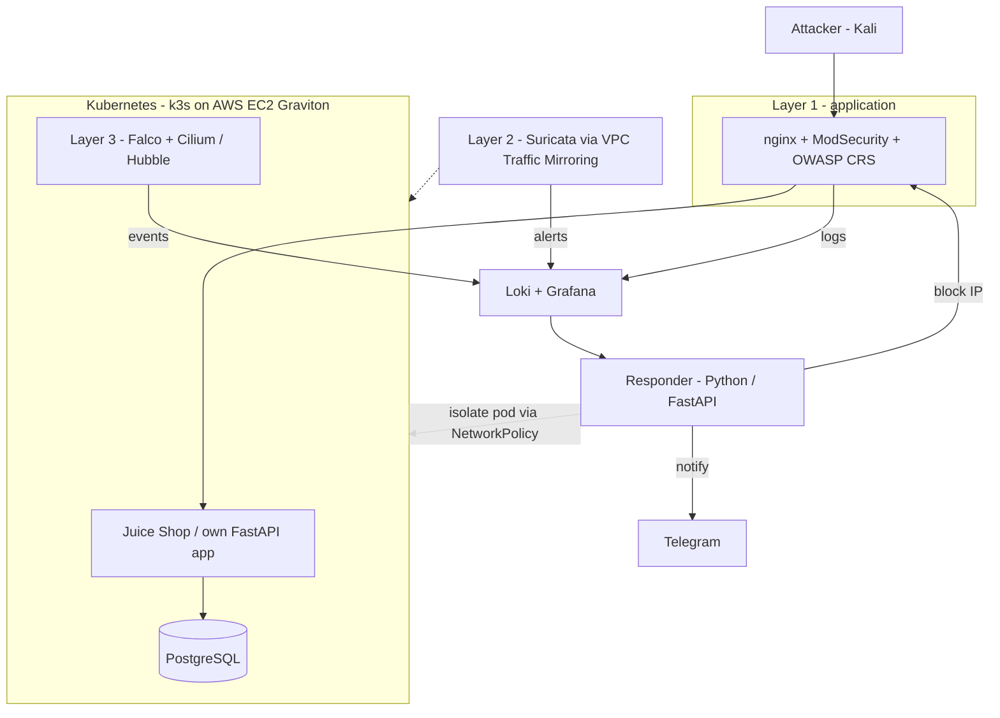

# k8s-defense-in-depth

Engineering thesis project (WSEI Lublin, Cybersecurity and Network Technologies):
**design and implementation of a multi-layer system for detecting and automatically
responding to attacks on web applications in a Kubernetes environment (AWS).**

A web application runs in Kubernetes behind three independent protection layers.
The lab is attacked in a controlled way in several configurations, and the layers
are compared by detection rate, false positives, reaction time and performance cost.
A custom Python service correlates events from all layers and responds automatically.

> Everything here is meant to be attacked only inside my own lab environment.

## Target architecture



| Layer | Tooling | Sees |
|---|---|---|
| 1. Application | nginx, ModSecurity, OWASP CRS | SQLi, XSS, path traversal, brute force |
| 2. Network | Suricata, VPC Traffic Mirroring | scans, exploits, suspicious connections |
| 3. Runtime | Falco, Cilium | shell in container, secret access, lateral movement |
| Response | Python / FastAPI | correlates events, blocks IPs, isolates pods |

## Status

- [x] Layer 1 prototype on a local cluster (this commit)
- [ ] CRS tuning, rate limiting, JSON logs, Loki + Grafana
- [ ] Falco and Cilium
- [ ] Terraform + Ansible, deployment on AWS
- [ ] Suricata with VPC Traffic Mirroring
- [ ] Responder service
- [ ] Experiments and thesis text

Weekly progress notes are in [`docs/progress/`](docs/progress/).

## Quick start (macOS, Apple Silicon)

```bash
brew install orbstack k3d kubectl
# start OrbStack once from Applications

make up        # k3d cluster + Juice Shop + WAF
make attack    # same attacks directly and through the WAF
make logs      # which CRS rules matched
make down      # remove the cluster
```

After `make up`:

- through the WAF: http://localhost:8080
- directly to the app, no protection: http://localhost:8081

Expected result of `make attack`: SQL injection, XSS and path traversal pass through
when sent directly and return `403` through the WAF, while a normal request is allowed.

## Repository layout

```
k8s/base/      namespace and the vulnerable application
k8s/waf/       nginx + ModSecurity + CRS
scripts/       prerequisites check, attack demo
terraform/     AWS infrastructure (planned)
ansible/       node configuration (planned)
responder/     automatic response service (planned)
docs/          thesis notes and weekly progress
```
